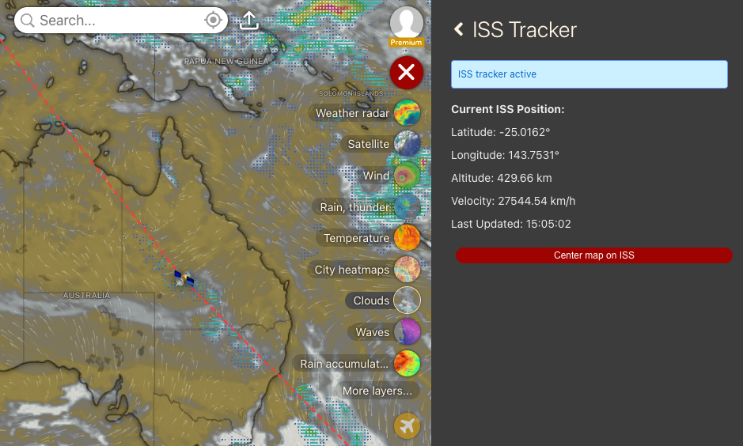

# 🛰️ Windy ISS Tracker Plugin

A [Windy.com](https://www.windy.com/) plugin to track the live position, orbital trajectory, and telemetry of the **International Space Station (ISS)** in real-time on top of global weather layers.



## Features

- 🛰️ **Live ISS Position**: Real-time marker on the Leaflet GL map showing current coordinates.
- 🚀 **Telemetry Data**: Live altitude (km), velocity (km/h), and coordinates updated every 30 seconds via [wheretheiss.at](https://wheretheiss.at/).
- 🌐 **Orbit Trajectory**: Projected path across the globe with antimeridian (date line) handling.
- 🎯 **Viewport Controls**: One-click "Center map on ISS" button in the right-hand panel.

---

## Installation

### Manual Installation (Direct CDN URL)

1. Open [Windy.com](https://www.windy.com/).
2. Open the main menu in the **top right** corner (hamburger icon) and select **Install Windy plugin** (or navigate directly to [windy.com/plugins](https://www.windy.com/plugins)).
3. Scroll down to the manual installation input field at the bottom.
4. Paste the direct Windy CDN URL:
   ```text
   https://windy-plugins.com/1003211/windy-plugin-iss-tracker/0.1.3/plugin.min.js
   ```
5. Click **Install**.
6. The **ISS Tracker** is now installed! You can launch it from the right-side menu or access it directly at:  
   **[windy.com/plugin/iss-tracker](https://www.windy.com/plugin/iss-tracker)**

---

## Local Development

If you want to run or test the plugin locally:

1. Clone and install dependencies:
   ```bash
   git clone https://github.com/vician/windy-plugin-iss.git
   cd windy-plugin-iss
   npm install
   ```
2. Start the development server in watch mode:
   ```bash
   npm start
   ```
3. Open [windy.com/developer-mode](https://www.windy.com/developer-mode).
4. Load the local plugin from:
   ```text
   https://localhost:9999/plugin.js
   ```

---

## Releasing a New Version

Version bumps and synchronization are handled automatically:

```bash
# 1. Bump version and sync src/pluginConfig.ts
npm version patch   # or minor / major

# 2. Push commit and tag to GitHub
git push --follow-tags
```

The GitHub Actions workflow will automatically build, package, and upload the new version to Windy.

---

## Known Bugs & Issues

- [ ] **[BUG] ISS position ignores Windy timeline / time shifter**:
  - **Problem**: When scrubbing the Windy timeline slider (or clicking Play to animate the forecast), the weather shifts through time while the ISS marker remains static at the current real-world timestamp.
  - **Potential Solutions**:
    - **Approach A (API-based)**: Listen to `store.on('timestamp')` and query `wheretheiss.at/v1/satellites/25544/positions`. Must implement strict debouncing (~400ms), in-memory caching, and request throttling (1.1s cooldown) to avoid hitting the 1 request/second API rate limit.
    - **Approach B (Client-side SGP4 / `satellite.js` - Recommended)**: Fetch the latest ISS TLE (Two-Line Element) from CelesTrak once and calculate the station's orbital position locally in JavaScript for any selected timestamp. Enables butter-smooth 60 FPS animation during timeline playback across the full 10-day forecast with zero network requests.
- [ ] **[BUG / UX] Sidebar UI needs a redesign**:
  - The current right-hand panel UI is basic and utilitarian. Needs to be rewritten with clean, modern card layouts, better typography, status badges, and styling that harmonizes natively with Windy's dark UI.

---

## Roadmap / TODO

- [ ] **Smooth Curved Orbital Trajectory**:
  - The current trajectory line connects only 10 discrete timestamps (the API limit) spaced 10 minutes apart (~4,500 km between points), making the orbit look like segmented straight lines with sharp bends.
  - Implement smooth curved interpolation (e.g., higher-density sampling via client-side propagation, great-circle geodesic paths, or Catmull-Rom spline interpolation) so the orbital ground track renders as a seamless, flowing sine curve across the map.
- [ ] **Visibility Footprint Circle**:
  - Render a line-of-sight horizon circle (`L.Circle`) on the map around the ISS using the telemetry `footprint` value (~2,200 km radius). Anyone inside this circle has direct line-of-sight to the station.
- [ ] **Solar Terminator & "Visible Pass" Calculation**:
  - Add a Day/Night solar terminator shadow overlay on the map.
  - Calculate real naked-eye visibility windows: identifying when an observer is in twilight/night (dusk/dawn, Sun elevation between -6° and -18°) while the ISS is in direct sunlight (not eclipsed by Earth's shadow).
  - Visually highlight the intersection where the ISS footprint overlaps the twilight zone.
- [ ] **Windy Cloud Forecast Integration**:
  - Pair visible passes with Windy's cloud cover forecasts to answer: *"Will the sky actually be clear when the ISS flies over me tonight?"*

---

## License

ISC License - see [package.json](package.json).
